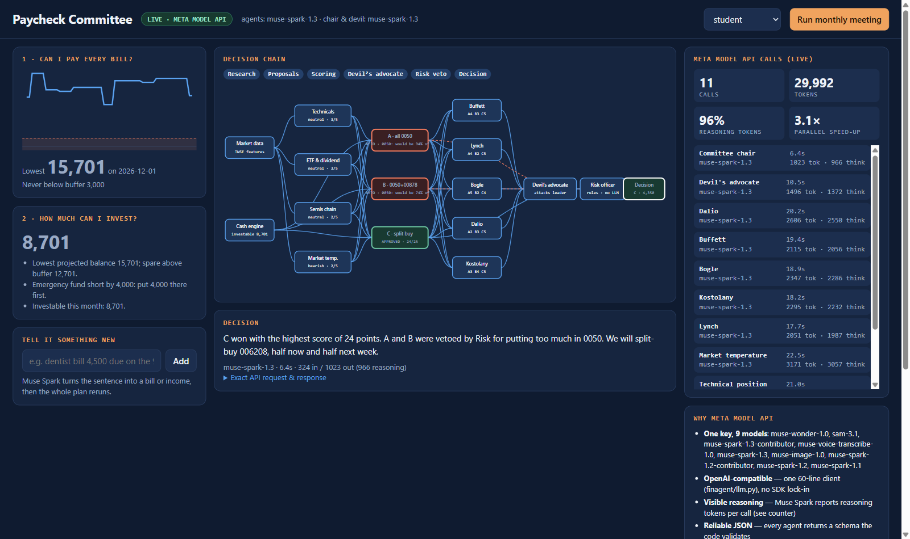

# Paycheck Committee — a Meta-model finance agent for people living paycheck to paycheck

Meta Global AI Developer Hackathon 2026 · Indie Dev Track

Every month it answers two questions:

1. **Can I pay every bill on time?** A day-by-day cash simulation finds the lowest balance and any shortfall, then lists the exact transfers to make.
2. **How much can I safely invest, and in what?** Bills come first, then the emergency fund. Whatever is left goes to an **investment committee of agents**: researcher agents write signal cards from market data, "master" personas (Buffett, Lynch, Bogle, Dalio, Kostolany) score 2–3 proposals, a devil's advocate attacks the winner, and a **risk officer that is a rule engine, not an LLM**, vetoes anything that breaks hard rules.



> All money math and rules are deterministic Python with unit tests. LLMs only interpret, argue and explain. The agent never places orders.

## Architecture

```
profile JSON / CSV ─► models.py (pydantic unified model)
                          │
                          ▼
                    engine.py ── simulate_cash() ─► shortfalls + transfers
                          │      investable_amount(): bills → emergency fund → invest
                          ▼
market.py (TWSE open data / offline sample) ─► features (MA20, MA60, 20d change)
                          │
                          ▼
committee.py  (roles.yaml, config-driven)
   4 researchers ──► signal cards        [Meta model, small tier]
   code drafts proposals (amounts from engine, never from LLM)
   5 masters ──► 1–5 scores              [Meta model, small tier]
   devil's advocate ──► attack           [Meta model, chief tier]
   risk.py ──► APPROVED / VETO           [rules only]
   chair ──► plain-language summary      [Meta model, chief tier]
                          │
                          ▼
cli.py ─► out/<name>_report.html + out/<name>_decision.json (decision log)
```

## Live committee room (the demo)

```bash
pip install -r requirements.txt
export MODEL_API_KEY='LLM|...'      # optional; without it everything runs in offline mock mode
python -m finagent.web               # http://127.0.0.1:8765
```

- **Decision-chain node graph** lights up as each agent finishes: market data → 4 researchers → proposals A/B/C → 5 investor personas → devil's advocate → risk officer → decision. Click any node for its output, the evidence it used and the **exact Meta Model API request and response**.
- **Live API log**: every call with model, latency, prompt/completion tokens and Muse Spark reasoning tokens; totals and the parallel speed-up.
- **Natural-language intake**: type "dentist bill 9,000 due on the 9th" → Muse Spark returns a structured bill → the whole plan reruns.
- Every run writes a full trace (`out/trace_*.jsonl`): prompt, raw reply, tokens, latency for each call.
- `python scripts/record_demo.py` records the scripted demo with Playwright (`out/video/*.webm`).

Measured on real runs (`examples/real_run/`): 11 calls to `muse-spark-1.3` per meeting, ~30k tokens of which 96% are reasoning tokens, 3.1× faster with parallel agents (under a minute per meeting).

## CLI

```bash
python -m pytest -q
python -m finagent.cli examples/personas/student.json        # can invest
python -m finagent.cli examples/personas/short_on_cash.json  # shortfall -> invest 0
```

A real run on `muse-spark-1.3` (decision logs + HTML reports) is in [`examples/real_run/`](examples/real_run/).

Without `MODEL_API_KEY` it runs in **offline mock mode**, so the demo works anywhere. To use Meta models (key from https://dev.meta.ai):

```bash
export MODEL_API_KEY='LLM|...'       # never commit
# optional: META_API_BASE (default https://api.meta.ai/v1), META_MODEL_CHIEF / META_MODEL_SMALL
```

## Meta models used

| Role | Tier | Default model |
|---|---|---|
| Researchers, masters | small | `muse-spark-1.3` (override with `META_MODEL_SMALL`) |
| Chair, devil's advocate | chief | `muse-spark-1.3` (override with `META_MODEL_CHIEF`) |

## Hard rules (risk officer)

- Buys never exceed this month's investable amount (bills and emergency fund first)
- No selling below average cost
- No adding to positions the user flagged high-risk or leveraged
- Single-holding cap and leveraged-ETF cap after the trade
- No margin, no borrowing

## Data and privacy

All personas and market prices in `examples/` are **synthetic**. No real ledgers, accounts or keys are in this repo.

## Disclaimer

AI role-play for education, not licensed financial advice.
